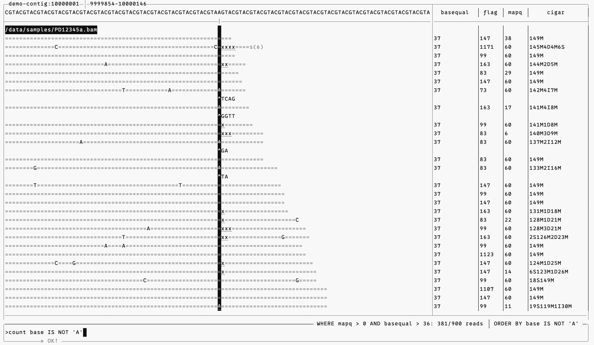

# `apb` - A Pileup Browser

`apb` is a terminal genome browser tailored to exploratory viewing of specifc loci, and flexible querying of aligned reads.
It is chiefly designed for verification and investigation of variant calls, but can be used to inspect the reads at any locus.
The built-in command line is capable of highly complex queries, but is tuned to make exploratory pattern hunting quick and seamless.

**Advantages:**
- Powerful SQL-based query syntax for intuitive investigation.
- Highly performant and responsive
  - On a 100k read pileup:
    - Keypress response: ~0.1ms.
    - Query submission: ~60ms.
  - On a 2 million read pileup:
    - Keypress response: ~0.1ms.
    - Query submission: 0.86s.
- Easily installed, including on compute cluster nodes.
- UI optimised specifically for inspecting pileup loci over general-purpose genome browsing.
- Immediately available in the terminal; no spinning up a web instance or navigating a web UI.



The TUI is split into 3 major regions. On the left you have an alignment viewer; on the right you have a table of per-read data. Information about the pileup locus is displayed at the top left of the alignment viewer. At the bottom you have a command line at which you can enter commands to query the reads and control the display. Commands are typed at the command promt `>`, and return messages are displayed below at the double chevron `»`. Queries are displayed at the top right of the command line (`WHERE`), including the count of reads matching the query.  

In the alignment pane, `=` matches the reference, `x` is a deletion, and a ring over a base marks an insertion, displayed beneath at `^`.  

The display is configurable; many additional columns may be viewed in the table, the alignment pane can display qualities in a number of ways, etc. The browser is navigated by simple readline based keybindings, and there is extensive and clear documentation available in the manual.  

**`apb` is pre-1.0!**
All features are subject to change. You may experience crashes or bugs - if so, please report them!
Feedback and feature requests are very much appreciated.

## Install

You will need a terminal emulator with basic unicode support. I expect the TUI should display successfully on almost any modern-ish emulator.
`apb` has been confirmed to work in iTerm2, ghostty, vscode, Terminal.app (the macOS default), and from within tmux.
If you have issues with rendering please report them.

Docker images are provided via the repo GitHub; check the `packages` tab to pull the latest release with docker, singularity, etc. This is
the easiest way to get `apb`.

Your experience may be improved by using a modern terminal font designed for legibility. I recommend https://www.programmingfonts.org/#oxproto.

### Building from source

Requires:
- a C++23 compiler (gcc ≥ 12 and clang ≥ 21 are both known to work)
- CMake ≥ 3.22
- `pkg-config`
- `sqlite3` ≥ 3.38
- `htslib` ≥ 1.17

`sqlite3` and `htslib` need to be discoverable via `pkg-config`. If htslib isn't packaged that way on your system, you can point the build
process at it directly with `-DHTSLIB_INCLUDE_DIR` and `-DHTSLIB_LIBRARY`. All other dependencies for the main binary are vendored with the
source.

```sh
cmake -S . -B build
cmake --build build
```

The compiled binary can be found at `build/apb`.

## Usage 

For CLI/TUI usage, command syntax, and query examples, you can generate a manual specific to your version with `apb --manual > MANUAL.md`
(Check `apb --help` for exact instructions for manual generation).

You may also read the copy of [MANUAL.md](MANUAL.md) shipped with the repository without building,
but note that it may not exactly correspond to your version of the tool!

If you are new to the tool, it is strongly recommend that you read the manual and try `apb --demo`. The manual is short and it's easy to miss some of the most powerful features otherwise!

## Development Roadmap

Feature suggestions are welcomed.
General suggestions regarding improvements to commands and navigation are also appreciated; nothing is fixed until 1.0.

### Planned Features

- ~Multiple alignment pileups.~ Added in `v0.2.0`.
- ~Performance improvements at ultra-high depth.~ Added in `v0.3.0`
- ~Allow saving queries and returning to them within the same session, without having to type them out again.~ Query recall added in `v0.4.0`.
- ~Optionally draw quality string as a sparkline graph (using unicode block characters) for reading at a glance,
  like so: `▁▂▃▄▅▆▇█▇▆▅▄▃▂▁`.~ Added in `v0.4.0` via `toggle sparkline` command.
- Allow display of individual SAM aux tags as columns in the table pane. Tags are currently fully queryable, but they cannot be displayed.
- Query syntax shorthand for referencing bases, qualities or CIGAR operations at loci in the pileup span other than the pileup locus itself,
  e.g. `where read_contains(+3, 5D)` would retrieve all reads with a 5-base deletion located 3 bases to the right of the pileup locus.
  This is not plausible in direct SQL. Exact syntax TBD!
- Various convenience features when writing queries at the command line, e.g. for doing `flag` comparisons without having to use bitwise operators.
- Headless querying, to get results for a query known ahead of time without dropping into the TUI.
  - Output format requires consideration.
  - This would allow use of apb programatically.
  - It may also be possible to expose apb as a library to scripting languages.

### Speculative Features

These are items that I think might be useful and could implement, but am unlikely to do so without requests - if you see something you would like, please ask!

- Arbitrary locus-jumping from within TUI - e.g. `goto chr1:2500`.
  - This feels like a nice idea, but I'm skeptical of how much time it saves over exiting the TUI and starting up again
    at the new locus via the CLI.
  - At very high depth it could give better performance as it would allow caching databases per locus if the user
    is likely to revisit each locus more than once within a session.
- Allow providing a list or file of loci at the CLI, and jumping between them in the TUI.
  - Three-column format - `contig`, `pos`, and, optionally, `id`. `id` would be arbitrary user data
    to identify each locus, e.g. a string like `REF:A-ALT:C`.
  - This would allow programmatic provisioning of loci from any data type which you can convert into
    this 3-col format. e.g. for VCF `bcftools view my.vcf | awk <extract columns and create id> > loci.txt`
  - For common cases like VCF to loci, examples of the necessary awk/cut/sed could be provided in the manual for those who are
    not familiar with those tools.
- Display of reads aligned to adjacent bases at the specified locus.

## Development

See [DEV.md](DEV.md) for a guide to the development of and contributing to `apb`.

