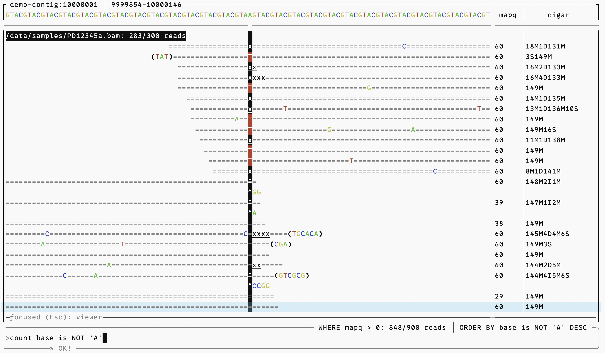

# `apb` - A Pileup Browser

APB ONLINE MANUAL: https://blex-max.github.io/apb-pileup-browser/

`apb` is a terminal genome browser and read searcher.  

The TUI is tailored to exploratory viewing and pattern hunting at loci; the search syntax enables querying the loci to answer questions from very simple to highly complex.

**Advantages:**
- Complete display of alignment features, including insertions, deletions and soft clips.
- Powerful SQL-based query syntax for intuitive exploration.
- Highly performant and responsive. On a 2 million read pileup:
    - Keypress response: ~0.1ms.
    - Query submission: <0.9s.
- Easily installed, including on compute cluster nodes.
- UI optimised specifically for inspecting pileup loci over general-purpose genome browsing.
- Immediately available in the terminal; no spinning up a web instance or navigating a web UI.



The TUI is split into two major regions. At the top you have the read viewer, made up of an alignment pane on the left and a table pane of per-read data on the right. Information about the pileup locus is displayed at the top left of the read viewer. At the bottom you have a command prompt at which you can enter commands to query the reads and control the display. Commands are typed at the command prompt `>`, and return messages are displayed below at the double chevron `»`. Queries are displayed at the top right of the prompt (`WHERE`), including the count of reads matching the query.  

In the alignment pane, `=` matches the reference, `x` is a deletion, and a ring over a base marks an insertion, displayed beneath at `^`. Soft clips are shown in brackets like `(ACTG)`, and hard clips as `h(length)`.

The display is configurable: many additional columns may be viewed in the table, the alignment pane can display qualities in a number of ways, masking with `=` can be turned on and off, etc. The browser is navigated by simple keybindings, and there is extensive and clear documentation available in the manual.  

apb was initially designed for viewing and querying the pileup at candidate variant loci, but has since proved useful in multiple contexts.

**`apb` is pre-1.0!**  
All features are subject to change. Feedback, bug reports, and feature requests are very much appreciated.

## Install

You will need a terminal emulator with basic unicode support. I expect the TUI should display successfully on almost any modern-ish emulator.
`apb` has been confirmed to work in iTerm2, ghostty, vscode, Terminal.app (the macOS default), and from within tmux.
If you have issues with rendering please report them.

Docker images are provided via the repo GitHub; check the `packages` tab to pull the latest release with docker, singularity, etc. This is
the easiest way to get `apb`.

Your experience may be improved by using a modern terminal font designed for legibility. I recommend https://www.programmingfonts.org/#oxproto.

### Building from source

Requires:
- a C++23 compiler (gcc ≥ 12 and clang ≥ 21 are both known to work)
- CMake ≥ 3.22
- `pkg-config`
- `sqlite3` ≥ 3.38
- `htslib` ≥ 1.17

`sqlite3` and `htslib` need to be discoverable via `pkg-config`. If htslib isn't packaged that way on your system, you can point the build
process at it directly with `-DHTSLIB_INCLUDE_DIR` and `-DHTSLIB_LIBRARY`. All other dependencies for the main binary are vendored with the
source.

```sh
cmake -S . -B build
cmake --build build
```

The compiled binary can be found at `build/apb`.

## Usage 

For CLI/TUI usage, command syntax, and query examples, you can generate a manual specific to your version with `apb --manual > MANUAL.md`
(Check `apb --help` for exact instructions for manual generation).

You may also read the copy of [MANUAL.md](MANUAL.md) shipped with the repository without building,
but note that it may not exactly correspond to your version of the tool!

If you are new to the tool, it is strongly recommend that you read the manual and try `apb --demo`. The manual is short and it's easy to miss some of the most powerful features otherwise!

## Development Roadmap

Feature suggestions are welcomed.
General suggestions regarding improvements to commands and navigation are also appreciated; nothing is fixed until 1.0.

### Planned Features

- Allow display of arbitrary user columns in the table pane, including display of SAM tags.
- Advanced motif and cigar searching extensions to the query parser.
- Useful shorthands for common query operations, like subsetting the view to only reads which are in proper pairs.
- Headless querying at the CLI, returning CSV results. This would allow use of apb programatically.
- Bindings to scripting languages such as `Python` and `R` to enable querying via scripts.
- Display of reads aligned to adjacent bases at the specified locus.
- Accept arbitrary sqlite databases at the command line as long as they minimally conform to `apb`'s expectations.

### Speculative Features

These are items that I think might be useful and could implement, but am unlikely to do so without requests - if you see something you would like, please ask!

- Arbitrary locus-jumping from within TUI - e.g. `goto chr1:2500`.
  - This feels like a nice idea, but I'm skeptical of how much time it saves over exiting the TUI and starting up again
    at the new locus via the CLI.
  - At very high depth it could give better performance as it would allow caching databases per locus if the user
    is likely to revisit each locus more than once within a session.
- Allow providing a list or file of loci at the CLI, and jumping between them in the TUI.
  - Three-column format - `contig`, `pos`, and, optionally, `id`. `id` would be arbitrary user data
    to identify each locus, e.g. a string like `REF:A-ALT:C`.
  - This would allow programmatic provisioning of loci from any data type which you can convert into
    this 3-col format. e.g. for VCF `bcftools view my.vcf | awk <extract columns and create id> > loci.txt`
  - For common cases like VCF to loci, examples of the necessary awk/cut/sed could be provided in the manual for those who are
    not familiar with those tools.

## Development

See [DEV.md](DEV.md) for a guide to the development of and contributing to `apb`.

